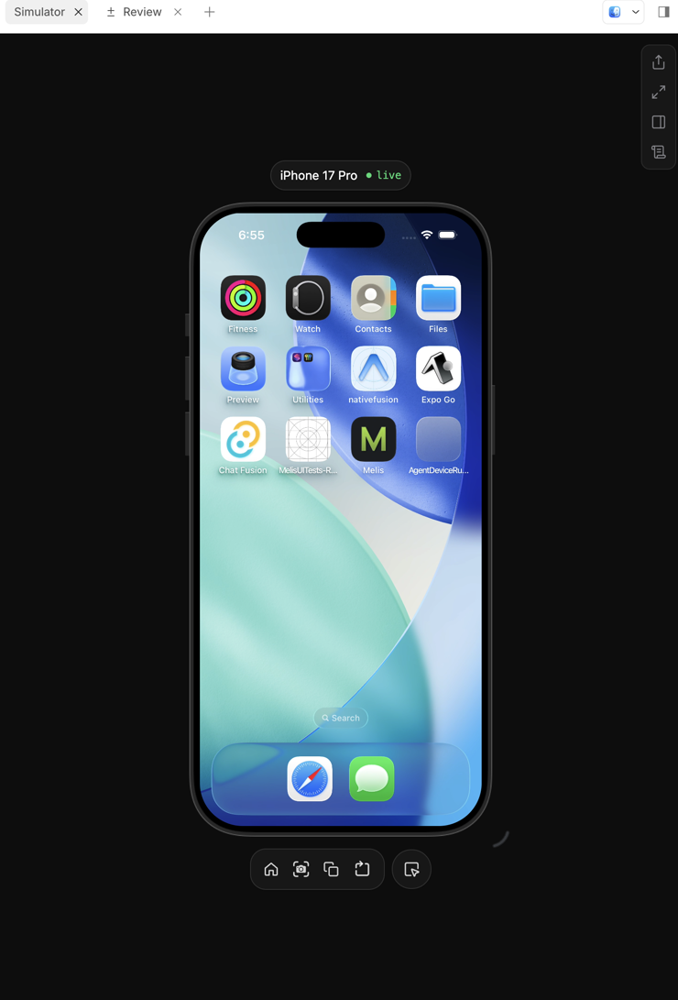

<div align="center">
  <br />
  <br />
  <h3>opencode-simulator</h3>
  <p>A live iOS Simulator inside OpenCode Desktop, with tools your agent can drive.</p>
  <br />
  <br />
</div>

<p align="center">
  
</p>

## What you get

- **A real simulator, in the panel.** The iOS Simulator streams into a side tab.
  Tap, drag, type, rotate, and press hardware buttons without leaving OpenCode.
- **Tools the agent can use.** 19 `sim_*` tools cover device lifecycle,
  accessibility reads, input, UI settings, screenshots, waits, and cleanup.
- **Session-scoped.** Every session remembers its simulator, and the panel opens
  in the session that called the tool, never a different one.
- **Parallel by default.** Two sessions can run two simulators at once,
  including two copies of the same iPhone model.
- **Warm copies.** After the first cold copy, a template makes new test devices
  in seconds instead of minutes. Copy leases expire automatically.
- **Bundled skill.** The plugin teaches the agent to use `sim_*` instead of
  `xcrun simctl`, Xcode, `axe`, or generated shell scripts.
- **Local only.** The stream binds to `127.0.0.1`. No telemetry, no hosted
  service.

## Install

Requires macOS with Xcode and an iOS runtime, OpenCode Desktop 2.2+, and Node
22+ on `PATH`.

Add the plugin to `~/.config/opencode/opencode.jsonc`:

```jsonc
{
  "$schema": "https://opencode.ai/config.json",
  "plugins": ["opencode-simulator"]
}
```

Using a checkout instead:

<details>
<summary>Local checkout</summary>

```sh
bun install
bun run build
```

Then add the checkout's absolute path to `plugins`.

</details>

AXe 1.8+ is recommended for accessibility reads and input. Without it, the
plugin falls back to serve-sim.

## Use

Start a device and open its panel:

```text
sim_start({ app: "com.example.app" })
```

The panel opens in the calling session, on that exact device. Then drive it:

```text
sim_ui({ mode: "interactive" })
sim_tap({ text: "Products" })
sim_wait({ text: "Products" })
sim_screenshot({ width: 500 })
```

You can also open **Simulator** from the side-panel menu or the command palette.

### Two sessions, same iPhone model

A simulator is a UDID. Two sessions on the same UDID share one screen, app
state, and set of taps. You do not have to manage that: when the only candidate
device is already used by another session, `sim_start` copies it and gives the
new session its own device.

```text
sim_start({ app: "com.example.app", label: "create order flow" })   # session 1
sim_start({ app: "com.example.app", label: "store profile" })       # session 2
```

The session that already owns the device keeps it. The other gets
`iPhone 17 Pro — store profile` instead of adding another "Copy 2". The copy
starts with a fresh install.

The first cold copy pays the simulator's first boot (minutes). While that
session runs, the plugin prepares a shut-down warm template in the background;
later copies clone it and boot in seconds. The panel opens immediately and shows
its loader during the boot.

To choose the source or name yourself, use `sim_create` first:

```text
sim_create({ from: "iPhone 17 Pro", app: "com.example.app" })
sim_start()
```

Delete a copy when the work is done:

```text
sim_delete({ udid: "iPhone 17 Pro — store profile" })
```

Automatic copies are leased and cleaned up after 14 days idle (shut down
copies only). List them with sizes and tags, or prune early:

```text
sim_devices({ disk: true })
sim_prune({ olderThanDays: 7, dryRun: true })
```

Passing the same `udid` to both sessions is still possible; that is an explicit
choice to share.

## Tools

| Tools | What they do |
|---|---|
| `sim_devices` `sim_boot` `sim_start` `sim_create` `sim_delete` `sim_prune` `sim_launch` | Device and app lifecycle, cleanup |
| `sim_status` `sim_ui` `sim_wait` `sim_screenshot` | Inspect the screen |
| `sim_tap` `sim_scroll` `sim_type` `sim_button` `sim_rotate` | Input and gestures |
| `sim_settings` `sim_keyboard` `sim_statusbar` | UI settings |

Arguments, return values, and failure modes live in
[docs/tools.md](docs/tools.md).

## How it works

The server part registers the tools and the bundled skill. The GUI part owns
the panel and one `serve-sim` process per device. `sim_start` asks the window to
open the tab in the calling session, and the main process streams the device
that session requested.

More detail: [docs/architecture.md](docs/architecture.md).

## Notes

- `serve-sim` must run under system Node, not Electron. If the stream says
  `Stream unavailable`, set `OPENCODE_SIMULATOR_NODE` to a Node 22+ path.
- Closing the panel stops its stream after 30 seconds. The simulator keeps
  running.
- `sim_delete` is destructive: it removes the simulator and all its data.
- The plugin keeps one shut-down `<model> — template` device per model/runtime.
  Copies clone it, so they cost almost no extra disk until they write. Delete it
  to force a fresh template.
- Automatic copies expire after 14 days idle. Change that with
  `OPENCODE_SIMULATOR_COPY_TTL_DAYS=N` or the plugin option `copyTtlDays`; `0`
  disables automatic cleanup. `sim_prune` runs it on demand.

## License

MIT
